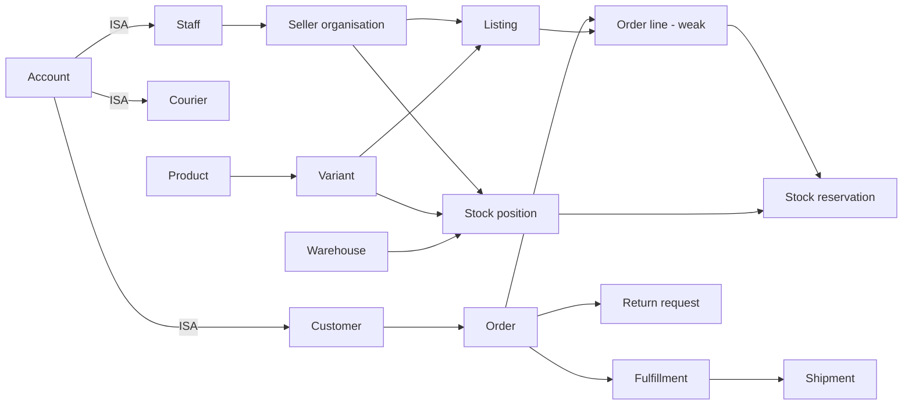

# Conceptual ER design

## Problem and boundaries

The system coordinates a marketplace with independent sellers. A customer buys listings; a listing is a seller's offer of a product variant. Warehouses may hold stock for multiple sellers. One order may contain lines from different sellers and be split across warehouses, so fulfillment and shipment are separate from the order. A delivered order can lead to a return and simulated refund.

The conceptual ER model, its diagrams and the two-part report are in [`REPORT.md`](REPORT.md) and [`er/`](er/). This file covers the implementation decisions behind `schema.sql` and `app.py`.

## Main path

This sketch only shows the main business path. It is not drawn in ER notation; the ER diagrams are in [`er/`](er/), and the four required concepts are explained in [`REPORT.md`](REPORT.md).

## Cardinality decisions

- A customer can place many orders; each order belongs to exactly one customer.
- An order has one or more order lines; each line belongs to exactly one order.
- A seller can offer many listings; a listing belongs to exactly one seller and one variant.
- A variant can be stocked by many sellers at many warehouses. A stock position identifies one exact triple.
- One order line can reserve stock from multiple warehouses; each reservation refers to one order line and one stock position.
- An order can have multiple fulfillments and shipments. A return request refers to one delivered order; each return line refers to one ordered line.

## Transaction and data-integrity rules

- The database enables foreign keys on every connection. Keys, positive quantities, valid statuses, and unique natural identifiers are constrained in `schema.sql`.
- Checkout uses `BEGIN IMMEDIATE`, verifies all cart quantities, allocates positions, decreases stock positions and batches, writes stock movements, inserts order/payment/invoice rows, clears the cart, then commits. Any failure rolls everything back.
- Fulfillment and delivery each update status and insert history in a single transaction. A second attempt on an already advanced order is rejected.
- The demo holds money as integer cents to avoid floating-point rounding in SQL.
- `accounts.role` must match the subtype table: triggers on `customers`, `staff` and `couriers` reject a mismatching row, which enforces the no-overlap rule of the ISA hierarchy.
- The schema models gift cards, coupons, purchase orders, inspections, and support, but the current web interface does not execute those workflows.
